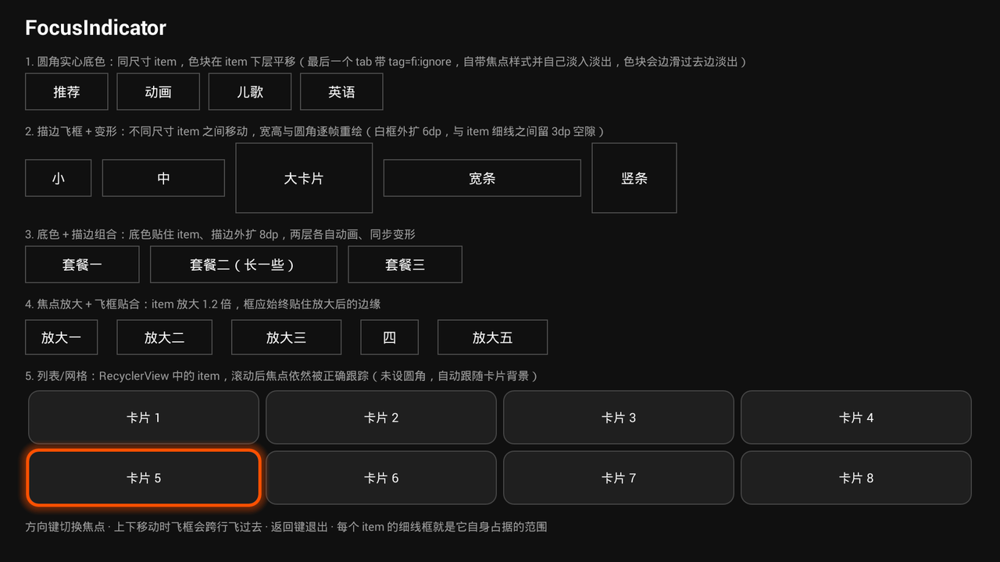
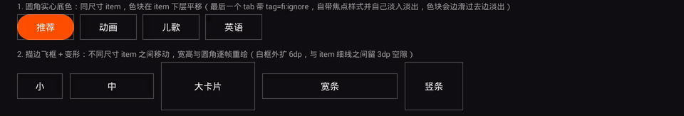
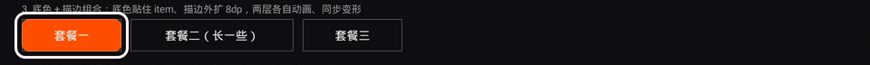

# FocusIndicator

Android TV / 机顶盒的焦点飞框库。焦点指示器从 item 里剥出来，作为独立浮层跟着焦点走；
跨行、跨列、跨容器时飞过去，不是原地闪现。



## 特性

- 只用 Framework API。`minSdk 17`，除 Kotlin 标准库外零依赖，不引入 AndroidX，可与 support library / AndroidX / Compose 项目共存。
- API 17 的盒子也能跑。动画期间每帧只重绘“上一帧 ∪ 当前帧”的脏区，重绘面积通常只有全屏的几十分之一。
- 真实变形。宽高与圆角逐帧重绘，不是 `scale` 拉伸，圆角不会椭圆化，描边粗细也不随比例变化。
- 三种视觉可自由组合。圆角实心底色、描边、外发光，两层独立配置、同步动画。
- 跟随放大动画。item 在焦点态自己做 `animate().scaleX(1.2f)` 时，飞框逐帧重采真实外形，始终贴住放大后的边缘。
- 跨容器接力。同页多个容器绑同一个 `Group`，上下换行时飞框从上一行飞过来。
- 可局部豁免。item 自带专属焦点样式时，给它加 `android:tag="fi:ignore"` 或调 `ignoreFocus(view)`，父容器的飞框对它淡出收场。
- 淡入淡出。飞框与底色的显示/隐藏走 alpha 过渡（默认淡入 180ms、淡出 140ms），底色退场与白框入场同时发生，跨容器不硬闪。
- 圆角自动跟随。不配 `corner()` 时读 item 自身的圆角（背景 shape / Outline），不同卡片不同圆角不用逐个配。
- 业务零侵入。item 只需 `focusable="true"`，不需要焦点态 selector、不需要背景、不需要任何回调。

## 效果预览

真机录制（Android 4.4 平板，GIF 已按实际速度回放）：

1. 圆角实心底色平移 + 单个 item 豁免。最后一个 tab 带 `tag="fi:ignore"`、自带焦点样式（用 `TransitionDrawable` 自己淡入淡出），色块对它淡出；随后按下键切到示例 2，底色淡出、白框淡入



2. 描边飞框 + 变形。不同尺寸 item 之间移动，宽高与圆角逐帧重绘


3. 底色 + 描边组合。两层各自动画、同步变形



4. 焦点放大 + 飞框贴合。item 放大 1.2 倍，框始终贴住放大后的边缘


5. 列表 / 网格。RecyclerView 复用 item，焦点移动后依然正确跟踪


## 目录结构

```
FocusIndicator/
├── focusindicator/          # 功能库（发布产物）
│   └── src/main/java/io/github/learnswood/focusindicator/
│       ├── FocusIndicatorLayout.kt   # 焦点飞框容器（FrameLayout）
│       └── FocusIndicatorView.kt     # 单层指示器绘制 View
├── app/                     # 示例 Demo（五种典型用法）
├── jitpack.yml              # JitPack 构建环境（JDK 17）
└── docs/                    # preview.png / preview-0*.gif 截图与录制；design.md 写实现细节
```

## 接入

### JitPack（远程依赖）

仓库：<https://github.com/learn-s-wood/FocusIndicator>

```kotlin
// settings.gradle.kts
dependencyResolutionManagement {
    repositories {
        google()
        mavenCentral()
        maven { url = uri("https://jitpack.io") }
    }
}
```

```kotlin
// 模块的 build.gradle.kts
dependencies {
    implementation("com.github.learn-s-wood:FocusIndicator:1.1.0")
}
```

坐标由 JitPack 按 GitHub 用户名 + 仓库名 + tag 生成，仓库名区分大小写（是 `FocusIndicator`，不是 `focusindicator`）。
版本号要与 GitHub 上的 tag 完全一致，当前 `1.1.0`，不带 `v` 前缀，可用版本见 [CHANGELOG.md](CHANGELOG.md)。
首次拉取时 JitPack 要现场构建，可能等几分钟。

### 源码模块（本地）

```kotlin
dependencies {
    implementation(project(":focusindicator"))
}
```

不需要额外配置：库除 Kotlin 标准库外没有任何依赖，`minSdk` 17 也不会抬高使用方的门槛。

## 快速开始

### 1. 界面里套一层容器

```xml
<io.github.learnswood.focusindicator.FocusIndicatorLayout
    android:id="@+id/fiTabs"
    android:layout_width="wrap_content"
    android:layout_height="wrap_content"
    android:clipChildren="false"
    android:clipToPadding="false">

    <LinearLayout
        android:layout_width="wrap_content"
        android:layout_height="wrap_content"
        android:clipChildren="false"
        android:orientation="horizontal">

        <TextView
            android:layout_width="88dp"
            android:layout_height="44dp"
            android:focusable="true"
            android:gravity="center"
            android:text="推荐" />

        <!-- 其余 item，同样只需 focusable="true" -->
    </LinearLayout>
</io.github.learnswood.focusindicator.FocusIndicatorLayout>
```

### 2. 配置视觉样式（Kotlin）

```kotlin
val container = findViewById<FocusIndicatorLayout>(R.id.fiTabs)

// 底层：圆角实心底色（会画在 item 之下）
container.behind()
    .fill(0xFFFF5000.toInt())
    .corner(dp(22))     // 不写这行就自动跟随 item 的圆角
    .padding(0f)

// 顶层：白色描边（画在 item 之上，不遮挡内容）
container.front()
    .stroke(Color.WHITE, dp(3))
    .corner(dp(12))
    .padding(dp(6))
```

### 3. 多行 / 多栏共享一个接力组（可选）

```kotlin
val group = FocusIndicatorLayout.Group()
row1.setGroup(group)
row2.setGroup(group)
row3.setGroup(group)
```

Java 用法完全一致：

```java
FocusIndicatorLayout container = findViewById(R.id.fi_tabs);
container.behind().fill(0xFFFF5000).corner(px(22)).padding(0);
container.front().stroke(Color.WHITE, px(3)).corner(px(12)).padding(px(6));
```

### 4. 让某个 item 不显示统一飞框（可选）

有些 item 自己就有一套焦点样式（描边动效、异形高亮、整卡换图），硬套统一飞框反而别扭。
两种写法任选，带标记的 View 整棵子树都不再参与统一飞框：

```xml
<!-- 推荐：写在 item 布局里，RecyclerView 复用时自动生效，不用维护任何调用 -->
<FrameLayout
    android:tag="fi:ignore"
    android:background="@drawable/bg_item_own_focus"
    android:focusable="true" ... />
```

```kotlin
// 需要按数据动态决定时：内部是 WeakHashMap，列表回收不会泄漏
container.ignoreFocus(holder.itemView)
container.isFocusIgnored(holder.itemView)   // 查询是否被豁免
container.unignoreFocus(holder.itemView)     // 取消豁免
```

豁免只说“容器别画”，焦点样式还得 item 自己出。容器不兜底。

同容器内焦点落到豁免项时，飞框会滑过去、路上淡完。这一步省不得：容器和接力组记的是
“上次隐藏的位置”，直接隐藏会留下更早那个普通 item 的坐标。`大卡片 → 英语（豁免）→ 儿歌`
这种走法，从英语离开时框就会从大卡片飞过来。

跨容器没这一段。常规跨容器本来就靠接力组交接，豁免项又没有自己的框，出发容器原地退场、
把接力点记成豁免项的位置就够了。

淡出停在路程 2/3 附近（默认参数约 134ms），框在碰到豁免项之前就没了。这个点绑的是路程
不是时间，`setDuration()` 调长也不会变成“贴到才消失”；`setFadeDuration()` 比它短时以它为准，
传 0 就是瞬时。

豁免项自己的焦点态最好也有过渡。selector 切换是瞬时的，这边淡了 130ms、那边啪一下全亮，
差得出来。`TransitionDrawable` 最省事（API 1 起，Demo 里英语 tab 用的就是它，120ms），
`AnimatedStateListDrawable` 要 API 21+，或者自己用 `ValueAnimator` 驱动 `Drawable.setAlpha()`。
库不管这件事，它不知道你的焦点态是背景、描边还是自绘。

### 5. 淡入淡出（可选）

默认走 alpha 过渡（淡入 180ms、淡出 140ms），一般不用动。开关不是布尔值而是时长，
传 0 就是瞬时（等于 1.0.0 的硬切）。淡入淡出分开配：

| 需求 | 写法 | 效果 |
| --- | --- | --- |
| 用默认值 | 不调用 | 淡入 180ms / 淡出 140ms |
| 改快慢 | `setFadeDuration(300, 200)` | 两者都保留，时长自定义 |
| 只关淡出 | `setFadeDuration(180, 0)` | 显示有渐变、隐藏瞬时 |
| 只关淡入 | `setFadeDuration(0, 140)` | 显示瞬时、隐藏有渐变 |
| 整体关闭 | `setFadeDuration(0, 0)` | 完全不透明跳变，隐藏时立即清空绘制层 |

```kotlin
container.setFadeDuration(180, 140)   // 默认值
container.setFadeDuration(180, 0)     // 只关淡出
container.setFadeDuration(0, 0)       // 关闭淡入淡出，回到硬切
```

配置是实例级的，运行时随便改。`fadeIn()` / `fadeOut()` 每次触发都读当前值，不用重建容器，
也不用重新走一遍 `behind()` / `front()`。按场景临时切就行：

```kotlin
override fun onPause() {
    container.setFadeDuration(0, 0)   // 页面退出时省掉无意义的过渡
    super.onPause()
}
```

底色块和描边层各管各的。焦点从 A 容器移到 B 容器时，A 的底色淡出、B 的描边淡入，同时发生。

不支持下面几种，需要时只能走代码：

- XML 属性。库没有 `res/attrs.xml`，布局里写不了淡入淡出的属性。
- 布尔开关。没有 `setFadeEnabled(false)`，用 `0` 表达。
- 读当前值。默认时长是 `private const`，没有 `getFadeDuration()`。
- 全局开关。配置在实例上，多个容器要逐个设。

### 6. 框与 item 的间隔 / 圆角自动跟随（可选）

两者都挂在 `Layer` 上，默认贴紧 item、跟随 item 圆角，不配也能用。

间隔用 `padding()`，它是相对 item 的外扩距离，默认 `0`。

```kotlin
container.behind().fill(accent).padding(0f)                    // 底色正好铺满 item
container.front().stroke(Color.WHITE, dp(3)).padding(dp(10))   // 描边推到 item 外 10dp
```

描边画在外扩后的矩形上，整条线宽都朝内占，从 item 边界往外看，剖面是这样：

```text
item 边界                      描边内沿        描边外沿
  │                              │← strokeWidth →│
  │←────── 缝隙 = padding − strokeWidth ──────→│
  │←──────────────── padding ────────────────→│
```

描边内侧与 item 之间的空隙 = `padding − 描边宽度`。比如 `stroke(3).padding(4)` 的缝隙是 `4 − 3 = 1`，`stroke(3).padding(10)` 留 `7`。

| stroke | padding | 缝隙 | 观感 |
| --- | --- | --- | --- |
| 3 | 3 | 0 | 描边内沿正好压在 item 边上 |
| 3 | 4 | 1 | 几乎贴边（1 在 2× 屏上只有 2 个物理像素） |
| 3 | 6 | 3 | 能看出细缝 |
| 3 | 8 | 5 | 间隔明显，框像浮在 item 外面 |
| 3 | 2 | −1 | 描边压进 item 内部 1 |

三个容易踩的坑：

- `padding ≤ strokeWidth` 时缝隙 ≤ 0，描边会盖住 item 的边缘甚至内部。想要框浮在外面的观感，两个值的差建议 ≥ 3。
- 两个参数都是 px，必须同单位。`stroke(Color.WHITE, dp(3))` 配 `.padding(4f)` 实际是 4px 外扩加 6px 描边，缝隙是负的。Demo 里统一过一遍 `dp()` 换算。
- 四角的空隙比侧边大。外扩矩形的圆角是 `目标圆角 + padding`，直角 item 的角是尖的，上面那个公式只对侧边严格成立。

想让空隙更大就继续加 `padding`，传负值则收进 item 内侧。

想确认到底隔了多少，给 item 加一圈范围线。注意不能用不透明背景（会盖住 `behind()` 的底色），要用只描边、不填充的，Demo 里的 `bg_item_bounds.xml` 就是 1px 半透明白线。飞框和这圈线之间的距离就是间隔。

圆角不写就自动跟随。不调 `corner()` 时，容器读目标 View 自己的圆角：API 21+ 先问 `Outline`，更早版本读背景 `GradientDrawable`，外面包了 `RippleDrawable` / `LayerDrawable` 就往下找一层。读到之后再叠上外扩量，圆角矩形外移 `p` 后圆角是 `r + p`，所以 `padding(2dp)` 配 10dp 圆角的卡片，框是 12dp。

```kotlin
val grid = findViewById<FocusIndicatorLayout>(R.id.fiGrid)
grid.front()
    .stroke(accent, dp(3))
    .padding(dp(2))        // 不写 corner，圆角跟着卡片走
```

列表里每张卡片圆角不同、或者以后改了卡片圆角，框都不用重配。要固定圆角就照旧 `.corner(px)`；想从固定值改回自动，用 `.cornerAuto()`（等价于 `.corner(-1f)`）。

自动模式取不到圆角时按直角画，不报错（背景是纯色，或者自定义 Drawable 没有 outline）。

## API

### FocusIndicatorLayout

| 方法 | 说明 |
| --- | --- |
| `behind()` | 底层视觉（在 item 之下）：圆角实心底色等会遮挡内容的视觉只能放这层 |
| `front()` | 顶层视觉（在 item 之上）：描边、外发光等不遮挡内容的视觉放这层 |
| `setGroup(group)` | 绑定跨容器接力组，同页多个容器共用一个 `Group` 即可跨行飞行 |
| `setDuration(ms)` | 飞框动画时长，默认 220ms |
| `setFadeDuration(fadeInMs, fadeOutMs)` | 显示/隐藏的淡入淡出时长，默认 180 / 140ms，传 `0` 关闭（可单独关一侧），详见 [第 5 节](#5-淡入淡出可选) |
| `ignoreFocus(view)` | 让某个子 View（及其子树）不显示统一飞框 |
| `unignoreFocus(view)` | 取消豁免 |
| `isFocusIgnored(view)` | 查询该 View 是否被豁免（含 `TAG_IGNORE` tag 方式） |
| `setAutoFollow(boolean)` | 关闭自动跟随，改为自行调用 `followTo()` |
| `setTrackTargetLayout(boolean)` | 是否逐帧重采目标外形，默认 `true`；item 焦点态不改尺寸时可关掉省测量 |
| `followTo(view)` | 手动飞行到指定 View |
| `snapTo(view)` | 直接对齐到指定 View（无动画），适合列表滚动后校正 |
| `requestSnap()` | 按当前焦点项重新对齐（无动画） |

### Layer（`behind()` / `front()` 返回，可链式调用）

| 方法 | 说明 |
| --- | --- |
| `fill(color)` | 圆角实心底色，传 `Color.TRANSPARENT` 关闭 |
| `stroke(color, widthPx)` | 描边，颜色 alpha 为 0 或宽度为 0 即关闭 |
| `glow(color, widthPx, layers = 6)` | 外发光，用同心环近似径向衰减。不用 `setShadowLayer`，API 19 老机器上不会掉进软件绘制。`layers` 是环数，越多越平滑，每帧多画一圈 |
| `padding(px)` | 相对 item 的外扩距离，默认 `0`；描边内侧与 item 的空隙 = `padding - 描边宽度`，负值表示内缩 |
| `corner(px)` | 圆角半径；不调用时自动跟随目标 View 的圆角，传负值恢复自动 |
| `cornerAuto()` | 恢复自动模式，圆角跟随目标 View |
| `enable(boolean)` | 整体开关某一层 |

所有尺寸单位都是 px。设计稿是 dp 的话自己换算，Demo 里的 `dp()` 就是 `value * density`。

### FocusIndicatorView

不想用容器时，这个类可以单独当绘制层：

```kotlin
val view = FocusIndicatorView(context)
view.setStyle(
    hasFill = true, fillColor = 0xFFFF5000.toInt(),
    hasStroke = true, strokeColor = Color.WHITE, strokeWidthPx = 3f,
    hasGlow = true, glowColor = 0x66FF5000, glowWidthPx = 4f
)
view.update(RectF(100f, 100f, 500f, 300f), radius = 20f)   // 每帧传当前外形
view.setContentAlpha(0.5f)                                // 淡入淡出
view.clear()                                              // 收起
```

`setStyle()` 只在样式变化时调。`update()` 的宽高是真实重绘，圆角传 px；`glowLayers` 有默认值 6，1.0.0 的 8 参调用照常可用。`hasIndicator()` 返回当前有没有画东西。

## 注意事项

1. item 不要设置不透明背景。底层实心底色画在 item 之下，item 有背景就会盖住色块。需要卡片底色的话，改用 `front()` 的描边 + 外发光，Demo 的网格场景就是这么做的。
2. 容器与所有祖先都要 `clipChildren="false"`。描边和外发光会画到 item 边界之外，跨容器飞行时起始位置甚至落在容器外。
3. 容器用 `wrap_content` 就行。库内部处理了“绘制层铺满容器但不撑开容器”的测量问题，不用写死高度。
4. item 焦点态做放大动画时别关掉 `setTrackTargetLayout`，否则飞框按拿到焦点那一刻的尺寸画，最后比 item 小一圈。
5. 列表滚动（尤其是 fling）时要持续校正。内置的贴合窗口只在焦点切换后跑 700ms，之后不再重采位置；`RecyclerView` / `ListView` 请在滚动回调里调 `requestSnap()`，或者直接 `snapTo(focusedView)`。
6. 一个容器包一组 item，别给每个 item 套一个容器。每个容器固定带 2 个绘制层 View 和 3 个 `Paint`，一屏几十个容器就是上百个多余 View。
7. 容器及其祖先不要做 `scale` 缩放。外形换算按“父级链不缩放”算，给容器或更上层加 `scaleX/scaleY` 会让飞框偏位。
8. 光晕在 API 19 的盒子上别开太大。`glow()` 半径建议 ≤ 8px、颜色 alpha ≤ 0x40；默认画 6 圈描边，范围放大或调大 `layers` 都会明显加重 GPU 混合的负担。
9. 豁免的 item 必须自己画焦点态。`fi:ignore` 只让容器闭嘴，item 没有 selector 或背景变化的话用户看不出焦点在哪。最好带点过渡，见第 4 节。
10. 自动圆角只读一次并缓存。缓存按“目标 View + 背景引用”判断，item 换了背景会重读；但背景内部的 selector 状态切换（同一个 `StateListDrawable` 在不同 state 下换 shape）不会重读，这类 item 请显式 `corner()`，或者保证各状态圆角一致。

## Demo

`app` 模块有五个场景，装到电视 / 盒子 / 模拟器上用遥控器操作（效果见上方效果预览）：

1. 同尺寸 tab + 圆角实心底色在 item 下层平移，最后一个 tab 用 `tag="fi:ignore"` 退出统一飞框
2. 不同尺寸 item + 描边飞框，观察宽高与圆角逐帧重绘的变形（描边外扩 6dp，与 item 留 3dp 空隙）
3. 底色层 + 描边层组合，两层同步变形（底色贴住 item、描边外扩 8dp）
4. item 焦点态放大 1.2 倍，验证飞框贴合放大后的边缘
5. RecyclerView 网格，验证列表复用场景；指示器不设 `corner()`，圆角自动跟随卡片背景

每个 item 都画了一圈 1px 范围线（`bg_item_bounds`），代表 item 自身的边界，用来对照飞框和 item 之间的空隙：示例 2 留 3dp、示例 3 留 5dp。示例 5 是反例，`padding 2dp` 小于 `stroke 3dp`，描边内沿压进卡片 1dp，看着就是贴着边画。

```bash
./gradlew :app:installDebug
```

## 环境

- 库：`minSdk 17` / `compileSdk 33` / Kotlin 1.8.10 / AGP 8.1.3，仅依赖 Kotlin 标准库
- Demo 额外引入了 `androidx.recyclerview:1.2.1`（`minSdk 14`），库本体不依赖 AndroidX

## 版本记录

变更历史见 [CHANGELOG.md](CHANGELOG.md)（含每个版本修了什么、行为有哪些变化）。
当前版本：`1.1.0`。

## License

[Apache License 2.0](LICENSE)
