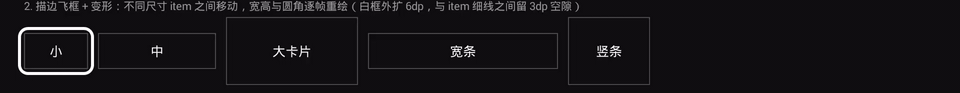
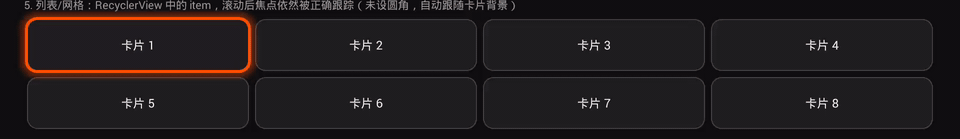

# FocusIndicator

Android TV / 机顶盒的焦点飞框库。焦点指示器从 item 里剥出来，作为独立浮层跟着焦点走；
跨行、跨列、跨容器时飞过去，不是原地闪现。


## 特性

- 零依赖。`minSdk 17`，只用 Framework API，除 Kotlin 标准库外不引入任何库，可与 support library / AndroidX / Compose 项目共存。
- 老设备不掉帧。动画期间只重绘变化的脏区，API 17 的盒子也能跑。
- 真实变形。宽高与圆角逐帧重绘，不是 `scale` 拉伸：圆角不椭圆化、描边不随比例变粗；item 自己做放大动画时框也贴得住。
- 三种视觉可组合。圆角实心底色、描边、外发光，两层独立配置、同步动画；显示与隐藏走淡入淡出（默认 180 / 140ms）。
- 跨容器接力。同页多个容器绑同一个 `Group`，上下换行时飞框从上一行飞过来。
- 业务零侵入。item 只需 `focusable="true"`。自带焦点样式的 item 可用 `tag="fi:ignore"` 豁免，不配 `corner()` 时圆角自动跟随 item。

## 效果预览

真机录制（Android 4.4 盒子）：

1. 圆角实心底色平移 + 单个 item 豁免。最后一个 tab 自带焦点样式（`TransitionDrawable` 自己淡入淡出），色块对它淡出；换到示例 2 时底色淡出、白框淡入


2. 描边飞框 + 变形。不同尺寸 item 之间移动，宽高与圆角逐帧重绘



3. 底色 + 描边组合。两层各自动画、同步变形


4. 焦点放大 + 飞框贴合。item 放大 1.2 倍，框始终贴住放大后的边缘


5. 列表 / 网格。RecyclerView 复用 item，焦点移动后依然正确跟踪



## 目录结构

```
FocusIndicator/
├── focusindicator/     # 功能库
├── app/                # Demo，五个典型场景
└── docs/               # 预览图与 GIF
```

## 接入

### JitPack（远程依赖）

仓库：<https://github.com/learn-s-wood/FocusIndicator>

```kotlin
// settings.gradle.kts
dependencyResolutionManagement {
    repositories {
        google()
        mavenCentral()
        maven { url = uri("https://jitpack.io") }
    }
}
```

```kotlin
// 模块的 build.gradle.kts
dependencies {
    implementation("com.github.learn-s-wood:FocusIndicator:1.1.0")
}
```

Groovy DSL 的写法：

```groovy
// settings.gradle
dependencyResolutionManagement {
    repositories {
        google()
        mavenCentral()
        maven { url 'https://jitpack.io' }
    }
}
```

```groovy
// 模块的 build.gradle
dependencies {
    implementation 'com.github.learn-s-wood:FocusIndicator:1.1.0'
}
```

Gradle 6.7 及更早没有 `dependencyResolutionManagement`，把 `maven { url 'https://jitpack.io' }` 写进根 `build.gradle` 的 `allprojects { repositories { } }` 即可。

版本号要与 GitHub 上的 tag 完全一致，当前 `1.1.0`，不带 `v` 前缀，可用版本见 [CHANGELOG.md](CHANGELOG.md)。

## 快速开始

### 1. 界面里套一层容器

```xml
<io.github.learnswood.focusindicator.FocusIndicatorLayout
    android:id="@+id/fiTabs"
    android:layout_width="wrap_content"
    android:layout_height="wrap_content"
    android:clipChildren="false"
    android:clipToPadding="false">

    <LinearLayout
        android:layout_width="wrap_content"
        android:layout_height="wrap_content"
        android:clipChildren="false"
        android:orientation="horizontal">

        <TextView
            android:layout_width="88dp"
            android:layout_height="44dp"
            android:focusable="true"
            android:gravity="center"
            android:text="推荐" />

        <!-- 其余 item，同样只需 focusable="true" -->
    </LinearLayout>
</io.github.learnswood.focusindicator.FocusIndicatorLayout>
```

### 2. 配置视觉样式

```kotlin
val container = findViewById<FocusIndicatorLayout>(R.id.fiTabs)

// 底层：圆角实心底色（会画在 item 之下）
container.behind()
    .fill(0xFFFF5000.toInt())
    .corner(dp(22))     // 不写这行就自动跟随 item 的圆角
    .padding(0f)

// 顶层：白色描边（画在 item 之上，不遮挡内容）
container.front()
    .stroke(Color.WHITE, dp(3))
    .corner(dp(12))
    .padding(dp(6))
```

Java 写法一样：

```java
FocusIndicatorLayout container = (FocusIndicatorLayout) findViewById(R.id.fiTabs);
container.behind().fill(0xFFFF5000).corner(px(22)).padding(0);
container.front().stroke(Color.WHITE, px(3)).corner(px(12)).padding(px(6));
```

### 3. 多行 / 多栏共享接力组（可选）

```kotlin
val group = FocusIndicatorLayout.Group()
row1.setGroup(group)
row2.setGroup(group)
```

```java
FocusIndicatorLayout.Group group = new FocusIndicatorLayout.Group();
row1.setGroup(group);
row2.setGroup(group);
```

### 4. 让某个 item 不显示统一飞框（可选）

有些 item 自己就有焦点样式（描边动效、异形高亮、整卡换图），硬套统一飞框反而别扭。
带标记的 View 整棵子树都不再参与统一飞框：  android:tag="fi:ignore"

```xml
<!-- 推荐：写在 item 布局里，RecyclerView 复用时自动生效，不用维护调用 -->
<FrameLayout
    android:tag="fi:ignore"
    android:background="@drawable/bg_item_own_focus"
    android:focusable="true" ... />
```

```kotlin
// 需要按数据动态决定时的等价 API（弱引用，不阻止列表回收）
container.ignoreFocus(holder.itemView)
container.isFocusIgnored(holder.itemView)   // 查询
container.unignoreFocus(holder.itemView)     // 取消
```

豁免只是让容器闭嘴，item 自己的焦点态还得自己出。飞框朝豁免项滑过去时会一路淡尽，
所以从豁免项离开时不会从更早那个 item 的坐标起飞。

豁免项的焦点态最好也有过渡（`TransitionDrawable` 或 `ValueAnimator`），否则这边淡了
130ms、那边直接跳亮，对比很明显。

### 5. 淡入淡出（可选）

默认淡入 180ms、淡出 140ms，一般不用动。开关是时长而不是布尔值：传 `0` 即瞬时。

| 需求 | 写法 | 效果 |
| --- | --- | --- |
| 用默认值 | 不调用 | 淡入 180ms / 淡出 140ms |
| 改快慢 | `setFadeDuration(300, 200)` | 时长自定义 |
| 只关淡出 | `setFadeDuration(180, 0)` | 显示有渐变、隐藏瞬时 |
| 只关淡入 | `setFadeDuration(0, 140)` | 显示瞬时、隐藏有渐变 |
| 整体关闭 | `setFadeDuration(0, 0)` | 跳变，隐藏时立即清空绘制层 |

配置是实例级的，运行时随时改，不用重建容器：

```kotlin
// 确定要退出页面时：省掉无意义的淡出，也不和窗口退场动画叠影
container.setFadeDuration(0, 0)
finish()
```

底色块和描边层各管各的。焦点从 A 容器移到 B 容器时，A 的底色淡出、B 的描边淡入，同时发生。

没有 XML 属性、布尔开关和 `getFadeDuration()`：配置只在代码里，关闭用 `0` 表达，多个容器要逐个设。

### 6. 框与 item 的间隔 / 圆角自动跟随（可选）

两者都挂在 `Layer` 上，默认贴紧 item、跟随 item 圆角。

`padding()` 是相对 item 的外扩距离，默认 `0`：

```kotlin
container.behind().fill(accent).padding(0f)                    // 底色铺满 item
container.front().stroke(Color.WHITE, dp(3)).padding(dp(10))   // 描边推到 item 外 10dp
```

描边整条线宽都朝内画，所以描边内侧与 item 的空隙 = `padding − 描边宽度`：

| stroke | padding | 空隙 | 观感 |
| --- | --- | --- | --- |
| 3 | 3 | 0 | 描边内沿压在 item 边上 |
| 3 | 6 | 3 | 能看出细缝 |
| 3 | 8 | 5 | 框像浮在 item 外面 |
| 3 | 2 | −1 | 描边压进 item 内部 1 |

三个坑：

- `padding ≤ strokeWidth` 时空隙 ≤ 0，描边会盖住 item 边缘。想要浮起来的观感，两者差建议 ≥ 3。
- 参数都是 px，必须同单位。`stroke(..., dp(3))` 配 `.padding(4f)` 实际是 6px 描边配 4px 外扩，空隙是负的。
- 四角空隙比侧边大：外扩矩形的圆角是 `目标圆角 + padding`，直角 item 的角是尖的。

圆角不写就自动跟随，读目标 View 背景或 Outline 的圆角：

```kotlin
grid.front()
    .stroke(accent, dp(3))
    .padding(dp(2))        // 不写 corner，圆角跟着卡片走
```

卡片圆角不同、或设计改了圆角，框都不用重配。固定圆角用 `.corner(px)`，改回自动用 `.cornerAuto()`；取不到圆角时按直角画，不报错。

### 7. 手动校正与接管（可选）

焦点一变框就自己飞，平时不用管。但内置的贴合窗口只跟着一次飞行跑 700ms，之后就停止重采位置，两种情况需要自己补：

焦点没变、位置变了（列表滚动、item 展开收起、转屏重排）。这时框停在旧位置，需要在变化后调一次 `snapTo()`：

```kotlin
recyclerView.addOnScrollListener(object : RecyclerView.OnScrollListener() {
    override fun onScrolled(rv: RecyclerView, dx: Int, dy: Int) {
        rv.findFocus()?.let { container.snapTo(it) }
    }
})
```

用 `snapTo()` 而不是 `requestSnap()`：后者会重跑一次跟随动画，放在滚动回调里每帧起一段新动画，看起来是框一直在后面追。

列表要把焦点项滚到中间时，想让框和列表同时到位（可选）。先算出焦点项居中后会平移多少，再让框飞到那个位置：

```kotlin
container.followToOffset(focused, dx.toFloat(), dy.toFloat())
```

`dx` / `dy` 是焦点项居中后相对当前位置的平移量，单位 px。位置就此固定：框停在落点上，飞行途中和动画结束后的贴合阶段都只更新宽高，不动中心。偏移量按内容范围钳制，列表到头时焦点项居中不了，偏移量就是 0，框落在焦点项当前位置。

完全手动接管：`setAutoFollow(false)` 后焦点在容器内变化不再自动跟随，由你决定何时、飞不飞；焦点离开容器时仍会正常退场。

| 方法 | 行为 |
| --- | --- |
| `followTo(view)` | 飞过去，走完整动画 |
| `followToOffset(view, dx, dy)` | 飞到 view 平移 (dx, dy) 之后的位置，位置固定，途中只改尺寸 |
| `snapTo(view)` | 直接落位，无动画 |
| `requestSnap()` | 找到当前焦点后跟一次（带动画，仅 autoFollow 开启时有效），适合“焦点没动、但想让框重新飞到位” |

## API

### FocusIndicatorLayout

| 方法 | 说明 |
| --- | --- |
| `behind()` | 底层视觉（在 item 之下）：圆角实心底色等会遮挡内容的视觉只能放这层 |
| `front()` | 顶层视觉（在 item 之上）：描边、外发光等不遮挡内容的视觉放这层 |
| `setGroup(group)` | 绑定跨容器接力组，同页多个容器共用一个 `Group` 即可跨行飞行 |
| `setDuration(ms)` | 飞框动画时长，默认 220ms |
| `setFadeDuration(fadeInMs, fadeOutMs)` | 显示/隐藏的淡入淡出时长，默认 180 / 140ms，传 `0` 关闭（可单独关一侧），详见 [第 5 节](#5-淡入淡出可选) |
| `ignoreFocus(view)` | 让某个子 View（及其子树）不显示统一飞框 |
| `unignoreFocus(view)` | 取消豁免 |
| `isFocusIgnored(view)` | 查询该 View 是否被豁免（含 `TAG_IGNORE` tag 方式） |
| `setAutoFollow(boolean)` | 关闭自动跟随，改为自行调用 `followTo()` / `snapTo()` |
| `setTrackTargetLayout(boolean)` | 是否逐帧重采目标外形，默认 `true`；item 焦点态不改尺寸时可关掉省测量 |
| `followTo(view)` | 飞到指定 View，走完整动画；起点优先接力组，其次上次位置 |
| `followToOffset(view, dx, dy)` | 飞到 view 平移 (dx, dy) 之后的位置，位置固定、尺寸跟随，途中只改宽高；列表滚动时让框和列表同时动 |
| `snapTo(view)` | 直接对齐到指定 View，无动画；列表滚动、尺寸变化后校正用 |
| `requestSnap()` | 按当前焦点重新跟随一次（带动画，仅 autoFollow 开启时有效），省掉自己 `findFocus()`；要瞬时贴合用 `snapTo(focused)` |

### Layer（`behind()` / `front()` 返回，可链式调用）

| 方法 | 说明 |
| --- | --- |
| `fill(color)` | 圆角实心底色，传 `Color.TRANSPARENT` 关闭 |
| `stroke(color, widthPx)` | 描边，颜色 alpha 为 0 或宽度为 0 即关闭 |
| `glow(color, widthPx, layers = 6)` | 外发光，用同心环近似径向衰减；`layers` 是环数，越多越平滑也越吃 GPU |
| `padding(px)` | 相对 item 的外扩距离，默认 `0`；描边内侧与 item 的空隙 = `padding - 描边宽度`，负值表示内缩 |
| `corner(px)` | 圆角半径；不调用时自动跟随目标 View 的圆角，传负值恢复自动 |
| `cornerAuto()` | 恢复自动模式，圆角跟随目标 View |
| `enable(boolean)` | 整体开关某一层 |

所有尺寸单位都是 px。设计稿是 dp 的话自己换算，Demo 里的 `dp()` 就是 `value * density`。

### FocusIndicatorView

不想用容器时，这个类可以单独当绘制层：

```kotlin
val view = FocusIndicatorView(context)
view.setStyle(
    hasFill = true, fillColor = 0xFFFF5000.toInt(),
    hasStroke = true, strokeColor = Color.WHITE, strokeWidthPx = 3f,
    hasGlow = true, glowColor = 0x66FF5000, glowWidthPx = 4f
)
view.update(RectF(100f, 100f, 500f, 300f), radius = 20f)   // 每帧传当前外形
view.setContentAlpha(0.5f)                                // 淡入淡出
view.clear()                                              // 收起
```

`setStyle()` 只在样式变化时调。`update()` 的宽高是真实重绘，圆角传 px。`hasIndicator()` 返回当前有没有画东西。

## 注意事项

1. item 不要设置不透明背景。底层实心底色画在 item 之下，item 有背景就会盖住色块。需要卡片底色的话，改用 `front()` 的描边 + 外发光，Demo 的网格场景就是这么做的。
2. 容器与所有祖先都要 `clipChildren="false"`。描边和外发光会画到 item 边界之外，跨容器飞行时起始位置甚至落在容器外。
3. 容器用 `wrap_content` 就行。库内部处理了“绘制层铺满容器但不撑开容器”的测量问题，不用写死高度。
4. item 焦点态做放大动画时别关掉 `setTrackTargetLayout`，否则飞框按拿到焦点那一刻的尺寸画，最后比 item 小一圈。
5. 列表滚动（尤其是 fling）时要持续校正。内置的贴合窗口只在焦点切换后跑 700ms，之后不再重采位置；`RecyclerView` / `ListView` 请在滚动回调里调 `snapTo(focusedView)`，细节见第 7 节。
6. 一个容器包一组 item，别给每个 item 套一个容器。每个容器固定多出 2 个绘制层 View。
7. 容器及其祖先不要做 `scale` 缩放。外形换算按“父级链不缩放”算，给容器或更上层加 `scaleX/scaleY` 会让飞框偏位。
8. 光晕在 API 19 的盒子上别开太大：半径 ≤ 8px、颜色 alpha ≤ 0x40，调大 `layers` 会更吃 GPU。
9. 豁免的 item 必须自己画焦点态。`fi:ignore` 只让容器闭嘴，item 没有 selector 或背景变化的话用户看不出焦点在哪。最好带点过渡，见第 4 节。
10. 自动圆角只在背景引用变化时重读。同一个 `StateListDrawable` 在不同 state 下换 shape 不会被感知，这类 item 请显式 `corner()`，或保证各状态圆角一致。

## Demo

`app` 模块有五个场景（效果见上方预览），装到电视 / 盒子 / 模拟器上用遥控器操作：

```bash
./gradlew :app:installDebug
```

每个 item 都画了一圈 1dp 细线框（`bg_item_bounds`）标出自身边界，用来对照飞框与 item 的空隙：示例 2 留 3dp、示例 3 留 5dp。示例 5 是反例，`padding 2dp` 小于 `stroke 3dp`，描边内沿压进卡片 1dp。

## 环境

- 库：`minSdk 17` / `compileSdk 33` / Kotlin 1.8.10 / AGP 8.1.3，仅依赖 Kotlin 标准库
- Demo 额外引入了 `androidx.recyclerview:1.2.1`（`minSdk 14`），库本体不依赖 AndroidX

## 版本记录

变更历史见 [CHANGELOG.md](CHANGELOG.md)（含每个版本修了什么、行为有哪些变化）。
当前版本：`1.1.0`。

## License

[Apache License 2.0](LICENSE)
